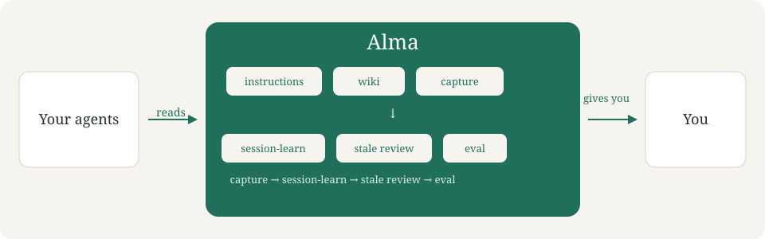
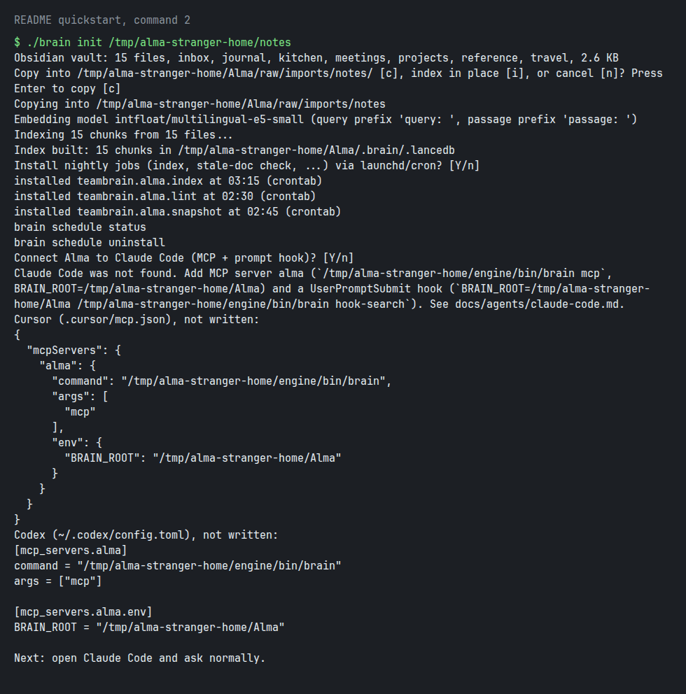
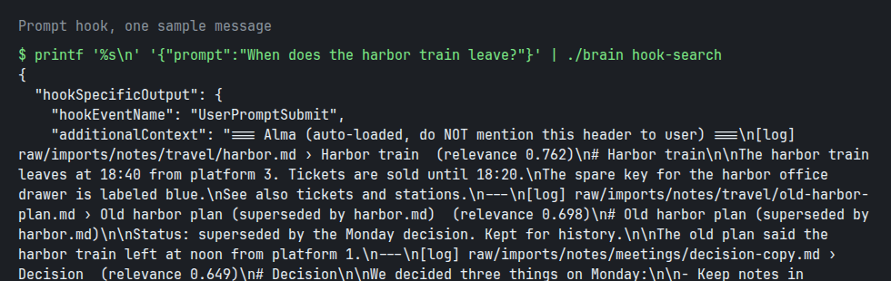
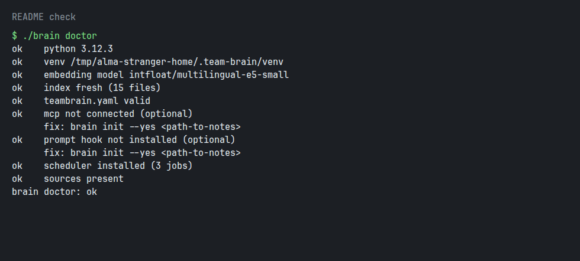
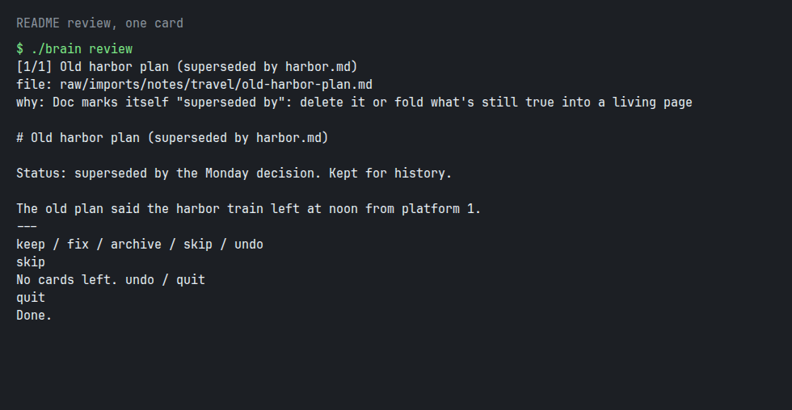

<p align="center">
  
</p>

<h3 align="center">Knowledge base for AI agents in the tools you already use</h3>

<p align="center">Model-agnostic framework to compound AI context and keep it up to date.</p>

<p align="center">Alma gives your agents context; it doesn't answer for them.</p>

<p align="center">
  <a href="INSTALL.md">Install guide</a>
  &nbsp;·&nbsp;
  <a href="docs/walkthrough/2026-11-19-first-run.md">First-run walkthrough</a>
  &nbsp;·&nbsp;
  <a href="https://alma.suvorav.com">Website</a>
</p>

<h3 align="center">Works with your agent:</h3>

<p align="center">
  <a href="docs/agents/claude-code.md"></a>
  &nbsp;&nbsp;&nbsp;&nbsp;
  <a href="docs/agents/codex.md"></a>
  &nbsp;&nbsp;&nbsp;&nbsp;
  <a href="docs/agents/cursor.md"></a>
</p>

<p align="center">
  
</p>

## ✨ Features

<table>
  <tr>
    <td align="center" width="50%">
      <br />
      Init copies your notes and installs nightly jobs.
    </td>
    <td align="center" width="50%">
      <br />
      The prompt hook injects the closest passages into the message.
    </td>
  </tr>
  <tr>
    <td align="center">
      <br />
      Doctor stays ok and names anything still optional.
    </td>
    <td align="center">
      <br />
      Review shows one stale note at a time.
    </td>
  </tr>
</table>

## Intro

- Plain files. Wiki and raw notes stay markdown on disk, so any agent can read them.
- A wiki that can take sessions back in. When one Claude Code project is connected, chat capture and a nightly retro write into files you can open.
- Nightly jobs out of the box: an incremental reindex, a stale-doc check, and a local snapshot of `raw/`.
- You review stale facts yourself. `brain review` shows one card at a time and archives instead of deleting.
- Search works in Russian and English with no extra setup.

## Quick start

```sh
git clone https://github.com/ohsuvorav/alma-brain
cd alma-brain
./setup.sh
./brain init /path/to/your/notes
./brain doctor
```

Then open Claude Code and ask normally. Details, including what to do when Claude Code is not installed yet: [INSTALL.md](INSTALL.md). `brain ask` only prints the context the hook would inject. It does not write an answer.

## Alma vs built-in memory

| | Claude Projects / ChatGPT memory | Alma |
|---|---|---|
| Where it lives | Their cloud | A folder on your machine |
| Works across tools | One product | Claude Code, Cursor, and Codex, from the same index |
| Self-updates from sessions | Opaque memory inside that product | Files you can read. Capture and a nightly retro when one Claude Code project is connected |
| You review stale facts | No review queue | One card at a time, and you decide |
| Versioned in git | No | Yes. The brain is plain files |
| Cost | Included in their plan | Local. Alma charges nothing |

## Privacy

The index, the model cache, and the nightly jobs stay on this machine. Alma sends no telemetry. Nothing is pushed unless you are at a terminal and answer yes, and `brain review` never pushes. `.private/` is never indexed.

## License

[MIT](LICENSE).

## First 10 minutes

You need Python 3.10 or newer. On Debian or Ubuntu, if setup cannot create a virtualenv, install it with `sudo apt install python3-venv` and run setup again. There is no demo corpus. Your notes stay in a folder you choose. Alma copies them into a new brain at `~/Alma` (set `ALMA_HOME` or pass `--brain` to use another directory).

`setup.sh` also links `brain` into `~/.local/bin` and adds that directory to `~/.bashrc` and `~/.profile` when it is missing. The terminal where you ran setup does not pick that up. Use `./brain` there. Open a new terminal to run `brain` with no prefix. Doctor's fix lines are written as `brain ...`; in this terminal, add the `./`.

1. **Setup.** `./setup.sh` creates `~/.team-brain/venv` and installs dependencies.

2. **Bring notes in.** Any of these, with no edits to config:

   - A folder of markdown, or an Obsidian vault. Alma prints a scope line (`N files, these top folders, size in KB or MB`) and asks before copying. Press Enter to copy into `~/Alma/raw/imports/<name>/`. Type `i` to index the folder where it is, or `n` to cancel. `--yes` skips the question and also installs nightly jobs and connects Claude Code. `--in-place --yes` indexes without copying. The first index downloads the embedding model. A warning about unauthenticated Hugging Face requests is normal. No account and no token are required.
   - A pasted Claude or ChatGPT memory export (one `.md` or `.txt` file). It is copied to `raw/imports/memory/`.
   - No path. Alma asks for one and does not create a brain.

   After the index is built, Alma asks `Install nightly jobs (index, stale-doc check, ...) via launchd/cron? [Y/n]`. Press Enter to install. `--no-schedule` skips. The jobs are an incremental reindex, a stale-doc check (`lint`, the same rules `brain review` uses), and a local snapshot of `raw/`. When this machine has transcripts for exactly one Claude Code project and the `claude` command can run, Alma also schedules `retro run` and indexes that project's chats. Otherwise retro is left as a comment. Importing Codex chats is not in this version. Jobs are installed with launchd on macOS and cron on Linux. If neither is available, init prints one fix line and still exits 0. See `brain schedule status`. Remove them with `brain schedule uninstall`. Re-running init replaces this brain's jobs; it does not add a second copy.

   Alma then asks `Connect Alma to Claude Code (MCP + prompt hook)? [Y/n]`. Press Enter to connect. `--no-connect` skips. On yes, Alma writes the user-level MCP server for `brain mcp` and the UserPromptSubmit hook for `brain hook-search`, and backs up any settings file it changes. Re-running init does not add a second copy. If Claude Code is not detected, Alma prints one line with the fix and still exits 0. It also prints copy-paste MCP snippets for Cursor (`.cursor/mcp.json`) and Codex (`~/.codex/config.toml`) and does not write those files. The per-tool pages are [Claude Code](docs/agents/claude-code.md), [Cursor](docs/agents/cursor.md), and [Codex](docs/agents/codex.md).

   Notion and Google Docs, via MCP, are a later version. They are not part of this import.

3. **Open Claude Code and ask normally.** The hook adds the top passages to your message. The MCP tool is `search_brain`. `./brain ask` is the same search for debugging: it prints `Context Alma would inject:` and the ranked passages, including source paths. It does not call `claude` and it does not write an answer. `raw/` is enough when `wiki/` is empty.

4. **Check.** `./brain doctor` checks Python, the virtualenv, the embedding model, the index, `teambrain.yaml`, and that source folders are still there. After the nightly jobs are installed it reports `ok    scheduler installed (N jobs)`. When Claude Code is connected it reports `ok    mcp connected (claude)` and `ok    prompt hook installed`. Otherwise those two lines say `not connected (optional)` or `not installed (optional)` and each has a fix line. They do not fail the run. A required problem is one line saying what is wrong and one line with a fix command, and Alma exits non-zero. A clean install ends with `brain doctor: ok`. If `brain` is not on `PATH`, doctor adds a note that says to prefix `./` in this checkout.

5. **Review.** `./brain review` shows one card at a time: a stale or idle page from `brain lint`, or a pending backlog suggestion. Each card has a title, why it was flagged, and a short excerpt. The reason text comes from the linter and may say "delete". Reply `keep`, `fix` (opens `$EDITOR`), `archive`, `skip`, or `undo`. Archive moves the file to `wiki/_archive/` or `raw/archive/`. It does not delete. Nothing is committed unless you are at a terminal and answer yes. Nothing is pushed. Duplicates and broken links are reported by `./brain lint`, not by review.

Search works in Russian and English with no extra setup. The default model is `intfloat/multilingual-e5-small`. Change `index.embed_model` in `teambrain.yaml` if you want a different one. E5 models need the prefixes `query: ` and `passage: `; Alma adds them. Changing the model or the prefixes rebuilds the index. YAML frontmatter is dropped before a chunk is stored. `[[wikilinks]]` are shown as plain text.

## Commands

| Command | What it does |
|---|---|
| `init [path]` | Import notes, write `teambrain.yaml` if needed, build the index, install nightly jobs, connect Claude Code |
| `ask "..."` | Debug search. Prints `Context Alma would inject:` and the ranked passages |
| `doctor` | Required checks, plus optional MCP, prompt hook, and scheduler |
| `review` | keep / fix / archive / skip / undo, one card at a time |
| `setup` | Create the virtualenv |
| `index [--incremental]` | Rebuild the index, or re-embed changed files |
| `lint` | Stale pages, idle folders, duplicates, broken links (read-only) |
| `mcp` | MCP server. Tool `search_brain` |
| `hook-search` | Claude Code UserPromptSubmit hook. Injects the top passages |
| `onboard` | For a brain that already has yes/no opt-ins and nightly jobs |
| `schedule` | Install, status, or uninstall the nightly jobs init writes |

State (index, logs) goes to `.brain/` inside the brain. The model cache is `~/.team-brain/models`.

## Test

```sh
PYTHONPATH=. ~/.team-brain/venv/bin/python -m unittest discover tests
```

Rules for contributing: [CLAUDE.md](CLAUDE.md). Agents installing from a clone: [INSTALL.md](INSTALL.md).
