# First run, 2026-11-19

A stranger's pass through Alma. The only instructions used were the README, then INSTALL.md. Nothing was looked up in the engine source while the commands below were run.

## Environment

- New home directory: `/tmp/alma-stranger-home`. No `~/.team-brain`, no model cache, no `~/.bashrc`.
- `PATH` is the system default. It does not contain `~/.local/bin`.
- Linux. Python 3.12.3 was already installed, including the venv package. The "install python3-venv" branch in the README was not hit.
- `claude` is not installed.
- Notes: 15 markdown files in `/tmp/alma-stranger-home/notes`, with an `.obsidian` directory, YAML frontmatter, `[[wikilinks]]`, Russian and English, one note that calls itself superseded, and one file copied so two notes share the same title and body. No demo corpus from the repository.

## Clock

Clone to the first answer (`./brain ask "what did I decide?"`):

| Step | Seconds |
|---|---|
| `git clone` (local copy of the tree) | 0.02 |
| `./setup.sh` | 15.31 |
| `./brain init` (including the first model download) | 4.32 |
| `./brain ask` | 2.31 |
| **Total** | **21.96** |

Clone, setup, init, and the first ask are the four timed commands. README quick start is `git clone`, `cd alma-brain`, `./setup.sh`, `./brain init`, and `./brain doctor`. A later section used `brain ask` with no `./`, and that one fails in this shell.

The clock above is the first pass, before nightly jobs. Init and doctor were run again after `brain init` started installing those jobs. Those re-runs are the init and doctor sections below. This home has no `claude` and no Claude Code transcripts, so retro stays commented out and three jobs are installed: index at 03:15, lint at 02:30, snapshot at 02:45.

## Steps

### Clone into an empty home

Command:

```sh
git clone https://github.com/ohsuvorav/alma-brain /tmp/alma-stranger-home/engine
```

Time: 0.02s. Exit: 0.

```text
Cloning into '/tmp/alma-stranger-home/engine'...
done.
```

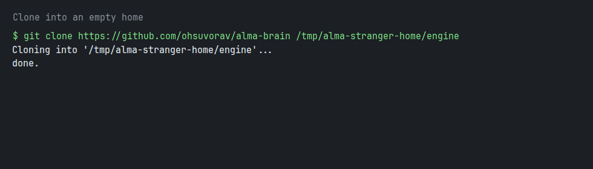

**Verdict: ok.** The command above is the public clone. The 0.02s in the clock is a local filesystem copy of the tree into an empty home. A fetch from the git host was not timed.

### README quickstart, command 1

Command:

```sh
./setup.sh
```

Time: 15.31s. Exit: 0.

```text
Alma: venv ready at /tmp/alma-stranger-home/.team-brain/venv
Alma: linked brain to /tmp/alma-stranger-home/.local/bin/brain and ./brain
Alma: next: ./brain init /path/to/your/notes
```

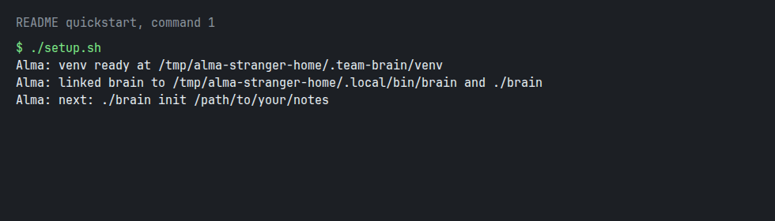

**Verdict: ok.** Setup created the virtualenv and linked `./brain` and `~/.local/bin/brain`. This machine already had Python 3.12.3 and the venv package, so the README's failure hint (`sudo apt install python3-venv`) was never reached. The README did not say Python 3.10+ was required before this command.

### README quickstart, command 2

Command:

```sh
./brain init /tmp/alma-stranger-home/notes
```

Time: 3.33s. Exit: 0. Re-run on the existing brain, so the model was already downloaded. Enter was pressed at the copy prompt, the nightly-jobs prompt, and the Claude Code prompt.

```text
Obsidian vault: 15 files, inbox, journal, kitchen, meetings, projects, reference, travel, 2.6 KB
Copy into /tmp/alma-stranger-home/Alma/raw/imports/notes/ [c], index in place [i], or cancel [n]? Press Enter to copy [c]
Copying into /tmp/alma-stranger-home/Alma/raw/imports/notes
Embedding model intfloat/multilingual-e5-small (query prefix 'query: ', passage prefix 'passage: ')
Indexing 15 chunks from 15 files...
Index built: 15 chunks in /tmp/alma-stranger-home/Alma/.brain/.lancedb
Install nightly jobs (index, stale-doc check, ...) via launchd/cron? [Y/n]
installed teambrain.alma.index at 03:15 (crontab)
installed teambrain.alma.lint at 02:30 (crontab)
installed teambrain.alma.snapshot at 02:45 (crontab)
brain schedule status
brain schedule uninstall
Connect Alma to Claude Code (MCP + prompt hook)? [Y/n]
Claude Code was not found. Add MCP server alma (`/tmp/alma-stranger-home/engine/bin/brain mcp`, BRAIN_ROOT=/tmp/alma-stranger-home/Alma) and a UserPromptSubmit hook (`BRAIN_ROOT=/tmp/alma-stranger-home/Alma /tmp/alma-stranger-home/engine/bin/brain hook-search`). See docs/agents/claude-code.md.
Cursor (.cursor/mcp.json), not written:
{
  "mcpServers": {
    "alma": {
      "command": "/tmp/alma-stranger-home/engine/bin/brain",
      "args": [
        "mcp"
      ],
      "env": {
        "BRAIN_ROOT": "/tmp/alma-stranger-home/Alma"
      }
    }
  }
}
Codex (~/.codex/config.toml), not written:
[mcp_servers.alma]
command = "/tmp/alma-stranger-home/engine/bin/brain"
args = ["mcp"]

[mcp_servers.alma.env]
BRAIN_ROOT = "/tmp/alma-stranger-home/Alma"

Next: open Claude Code and ask normally.
```

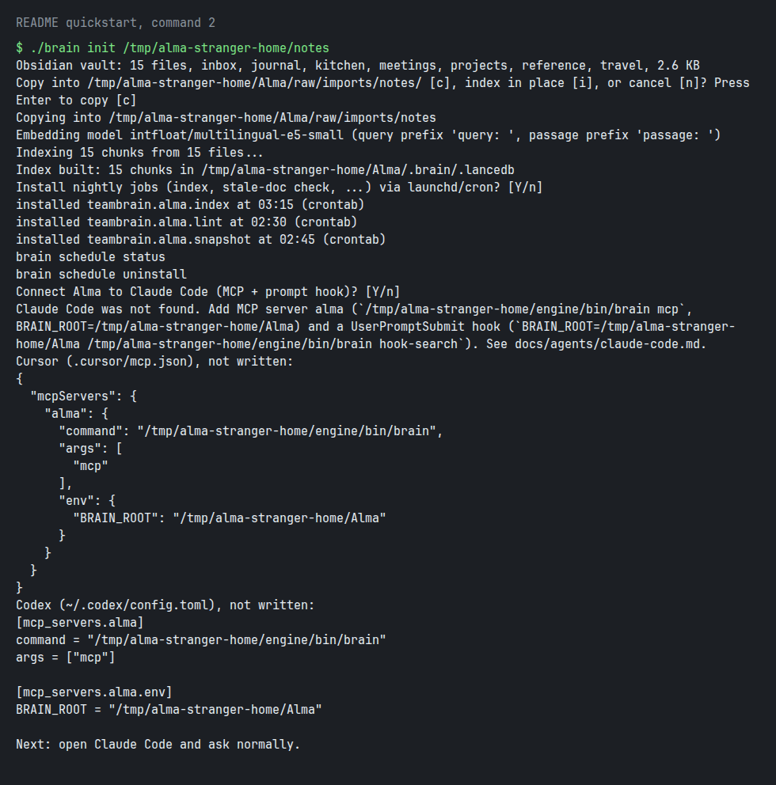

**Verdict: ok.** Enter copied the vault, Enter installed the three nightly jobs, and Enter tried to connect Claude Code. This home has no `claude` command and no `~/.claude`, so init printed one line and the Cursor and Codex snippets, then exited 0. It did not write `.cursor/mcp.json` or `~/.codex/config.toml`. Retro is still commented out.

### README quickstart, command 3 — first answer

Command:

```sh
./brain ask "what did I decide?"
```

Time: 2.31s. Exit: 0.

```text
[log] raw/imports/notes/meetings/decision-copy.md › Decision  (relevance 0.695)
# Decision

We decided three things on Monday:

- Keep notes in markdown, not in a new app.
- Search them in Russian and English.
- Take the harbor train at 18:40 instead of the noon train.

[log] raw/imports/notes/meetings/decision.md › Decision  (relevance 0.695)
# Decision

We decided three things on Monday:

- Keep notes in markdown, not in a new app.
- Search them in Russian and English.
- Take the harbor train at 18:40 instead of the noon train.

[log] raw/imports/notes/home.md › Home  (relevance 0.667)
---
title: Home
tags: [index]
---

# Home

This vault is the place for trips, the kitchen, and Monday decisions.
Start with [[harbor]] and [[Вечерний чай]]. The latest call is in [[Decision]].

[log] raw/imports/notes/inbox/ideas.md › Ideas  (relevance 0.646)
---
status: inbox
---

# Ideas

Maybe draw a map of platform 3.
Do not store passwords in this vault.

[log] raw/imports/notes/travel/old-harbor-plan.md › Old harbor plan (superseded by harbor.md)  (relevance 0.641)
# Old harbor plan (superseded by harbor.md)

Status: superseded by the Monday decision. Kept for history.

The old plan said the harbor train left at noon from platform 1.
```

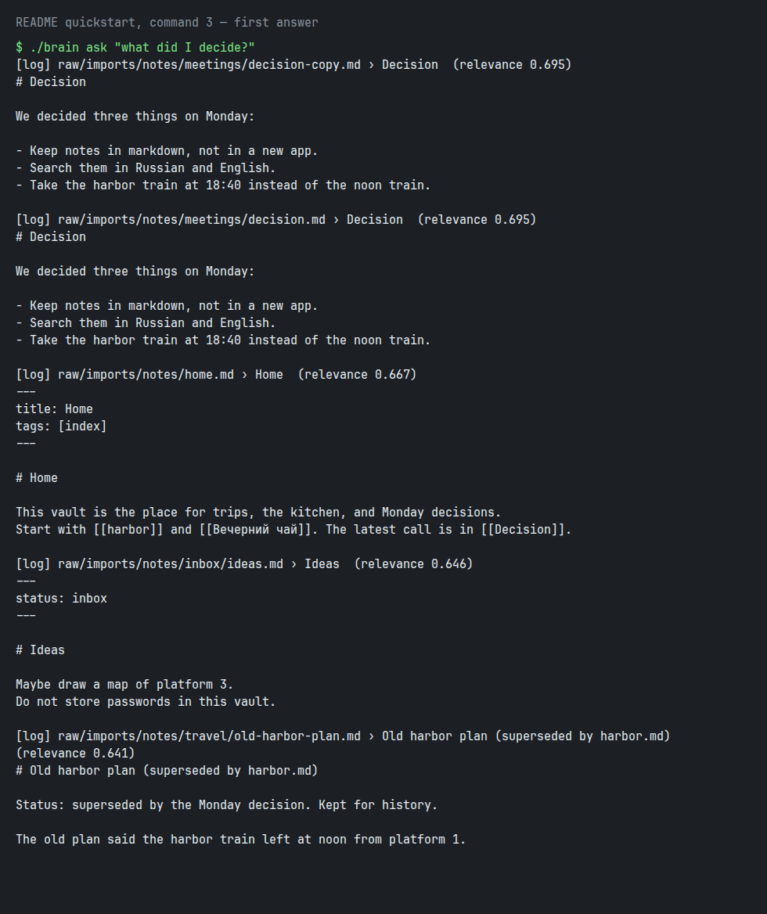

**Verdict: confusing.** Exit 0, and the top passages are the Monday decision (shown twice, because the notes folder contains two identical copies). There is no sentence that answers in prose. `claude` is not installed, and the output does not say so. A stranger can still read the decision off the first passage. Frontmatter was not in this particular hit.

### First 10 minutes says `brain ask`, without ./

Command:

```sh
brain ask "When does the harbor train leave?"
```

Time: 0.0s. Exit: 127.

```text
bash: line 1: brain: command not found
```


**Verdict: broken.** The shell that ran `./setup.sh` does not have `~/.local/bin` on `PATH`. The quickstart uses `./brain`. Sections 3 to 5 then drop the `./`. Following those sections literally stops here with `command not found`.

### English question, using ./brain

Command:

```sh
./brain ask "When does the harbor train leave?"
```

Time: 2.54s. Exit: 0.

```text
[log] raw/imports/notes/travel/harbor.md › Harbor train  (relevance 0.764)
---
title: Harbor train
tags: [travel]
---

# Harbor train

The harbor train leaves at 18:40 from platform 3. Tickets are sold until 18:20.
The spare key for the harbor office drawer is labeled blue.
See also [[tickets]] and [[stations]].

[log] raw/imports/notes/travel/old-harbor-plan.md › Old harbor plan (superseded by harbor.md)  (relevance 0.698)
# Old harbor plan (superseded by harbor.md)

Status: superseded by the Monday decision. Kept for history.

The old plan said the harbor train left at noon from platform 1.

[log] raw/imports/notes/meetings/decision-copy.md › Decision  (relevance 0.649)
# Decision

We decided three things on Monday:

- Keep notes in markdown, not in a new app.
- Search them in Russian and English.
- Take the harbor train at 18:40 instead of the noon train.

[log] raw/imports/notes/meetings/decision.md › Decision  (relevance 0.649)
# Decision

We decided three things on Monday:

- Keep notes in markdown, not in a new app.
- Search them in Russian and English.
- Take the harbor train at 18:40 instead of the noon train.

[log] raw/imports/notes/travel/tickets.md › Tickets  (relevance 0.646)
# Tickets

Buy the harbor ticket before 18:20. The noon train is the old plan and is not the one we take.
A return ticket costs 12 coins at the window, cash only.
```

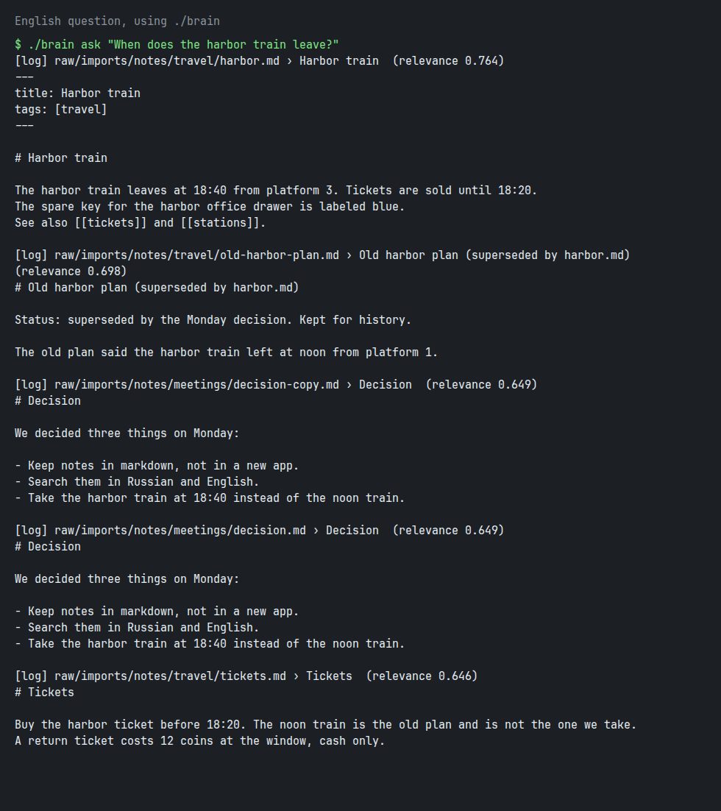

**Verdict: ok.** The top passage is `travel/harbor.md` and it says the train leaves at 18:40 from platform 3. The chunk also prints YAML frontmatter and `[[tickets]]` links, which are not followed. The answer is in the text.

### Russian question

Command:

```sh
./brain ask "Какой чай заваривать вечером?"
```

Time: 2.29s. Exit: 0.

```text
[log] raw/imports/notes/kitchen/tea.md › Вечерний чай  (relevance 0.817)
---
title: Вечерний чай
tags: [kitchen]
---

# Вечерний чай

Вечерний чай — иван-чай. Заваривать 10 минут в горячей воде, без сахара.
Утром вместо этого чёрный чай, 4 минуты.

[log] raw/imports/notes/journal/2026-11-18.md › 18 ноября  (relevance 0.731)
# 18 ноября

Вечером заварил иван-чай. Десять минут, без сахара, как записано на карточке.
Завтра снова на поезд в 18:40.

[log] raw/imports/notes/kitchen/borscht.md › Борщ  (relevance 0.585)
# Борщ

Борщ варится на говяжьем бульоне два часа. Свёклу класть в конце, чтобы цвет остался ярким.
Подавать со сметаной.

[log] raw/imports/notes/home.md › Home  (relevance 0.559)
---
title: Home
tags: [index]
---

# Home

This vault is the place for trips, the kitchen, and Monday decisions.
Start with [[harbor]] and [[Вечерний чай]]. The latest call is in [[Decision]].

[log] raw/imports/notes/kitchen/pantry.md › Pantry  (relevance 0.513)
# Pantry

Ivan tea is on the top shelf. Black tea is in the tin by the kettle.
There is no coffee in this kitchen.
```

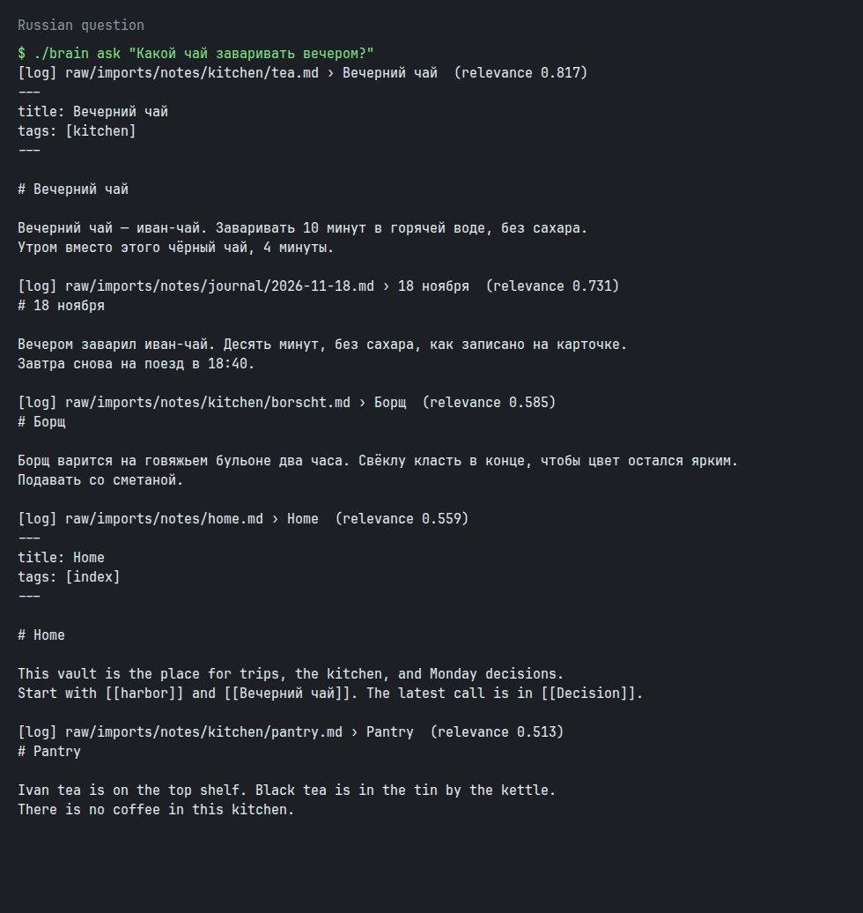

**Verdict: ok.** The top passage is `kitchen/tea.md`: evening tea is ivan-chai, brew for 10 minutes, no sugar. Russian search worked with no extra setup. Frontmatter is printed above the heading.

### Question the notes only answer by saying it was not discussed

Command:

```sh
./brain ask "What is the office wifi password?"
```

Time: 2.29s. Exit: 0.

```text
[log] raw/imports/notes/meetings/monday.md › Monday standup  (relevance 0.706)
# Monday standup

We talked about the harbor trip and the kitchen list.
Nobody mentioned a wifi password. The office network was not discussed.

[log] raw/imports/notes/inbox/ideas.md › Ideas  (relevance 0.635)
---
status: inbox
---

# Ideas

Maybe draw a map of platform 3.
Do not store passwords in this vault.

[log] raw/imports/notes/meetings/decision-copy.md › Decision  (relevance 0.518)
# Decision

We decided three things on Monday:

- Keep notes in markdown, not in a new app.
- Search them in Russian and English.
- Take the harbor train at 18:40 instead of the noon train.

[log] raw/imports/notes/meetings/decision.md › Decision  (relevance 0.518)
# Decision

We decided three things on Monday:

- Keep notes in markdown, not in a new app.
- Search them in Russian and English.
- Take the harbor train at 18:40 instead of the noon train.

[log] raw/imports/notes/travel/harbor.md › Harbor train  (relevance 0.516)
---
title: Harbor train
tags: [travel]
---

# Harbor train

The harbor train leaves at 18:40 from platform 3. Tickets are sold until 18:20.
The spare key for the harbor office drawer is labeled blue.
See also [[tickets]] and [[stations]].
```

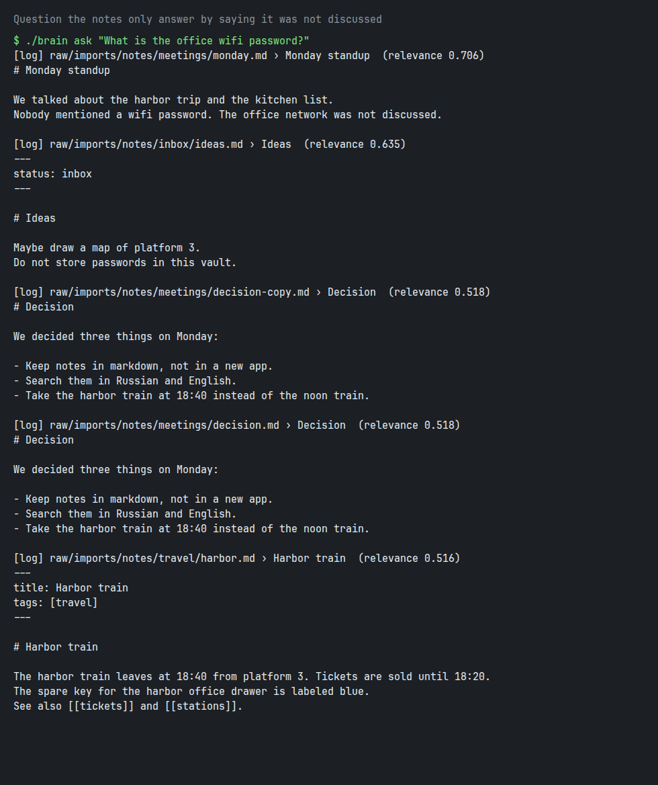

**Verdict: confusing.** The top note says nobody mentioned a wifi password. That is useful, but the output presents it as a ranked hit with relevance 0.706 and no line that says this is not a written answer. The notes happened to mention wifi. The next step asks something the notes do not mention at all.

### Question with no answer in the notes, after the model directory was removed

Command:

```sh
./brain ask "What is the garage door code?"
```

Time: 4.0s. Exit: 0.

```text
Fetching 5 files: 100%|██████████| 5/5 [00:01<00:00,  4.11it/s]
Warning: You are sending unauthenticated requests to the HF Hub. Please set a HF_TOKEN to enable higher rate limits and faster downloads.
[log] raw/imports/notes/projects/labels.md › Labels  (relevance 0.599)
# Labels

Ticket folders use a short code like TRN-1840 for the harbor train.
The kitchen list has no code.

[log] raw/imports/notes/inbox/ideas.md › Ideas  (relevance 0.573)
---
status: inbox
---

# Ideas

Maybe draw a map of platform 3.
Do not store passwords in this vault.

[log] raw/imports/notes/journal/2026-11-01.md › 1 November  (relevance 0.542)
# 1 November

Walked to the harbor and checked platform 3. The board said 18:40.
Bought bread on the way home.

[log] raw/imports/notes/travel/harbor.md › Harbor train  (relevance 0.538)
---
title: Harbor train
tags: [travel]
---

# Harbor train

The harbor train leaves at 18:40 from platform 3. Tickets are sold until 18:20.
The spare key for the harbor office drawer is labeled blue.
See also [[tickets]] and [[stations]].

[log] raw/imports/notes/home.md › Home  (relevance 0.526)
---
title: Home
tags: [index]
---

# Home

This vault is the place for trips, the kitchen, and Monday decisions.
Start with [[harbor]] and [[Вечерний чай]]. The latest call is in [[Decision]].
```

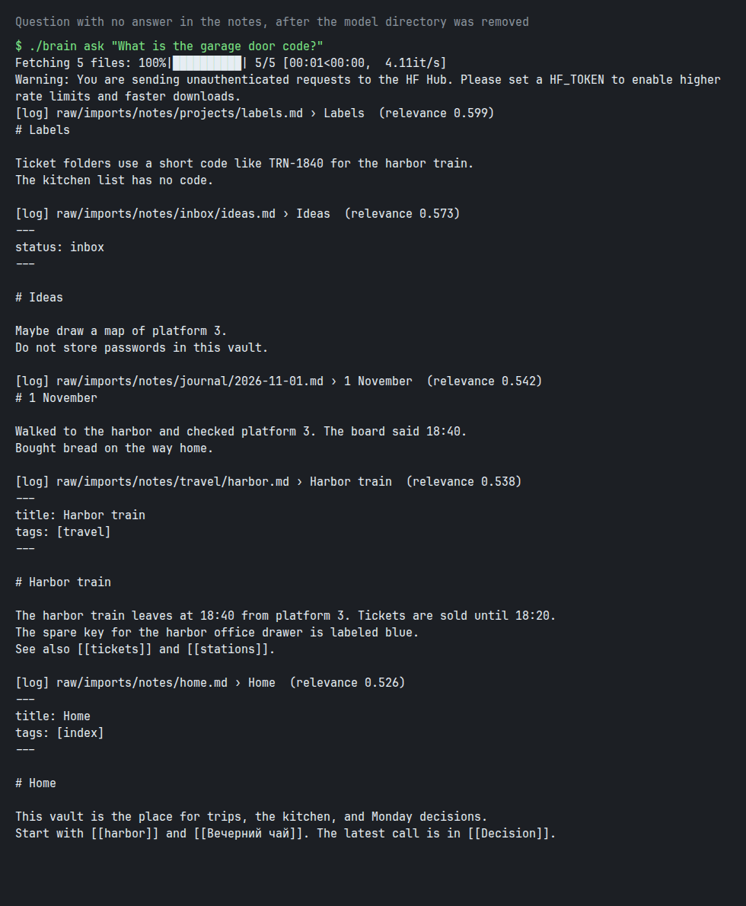

**Verdict: confusing.** Nothing in the 15 notes mentions a garage or a door code. Alma still printed five passages, the best at relevance 0.599, and did not say the notes do not contain it. It also downloaded the embedding model again on its own (the model directory had just been deleted) and repeated the Hugging Face token warning. Exit code was 0.

### README check

Command:

```sh
./brain doctor
```

Time: 1.03s. Exit: 0. Re-run after the init above.

```text
ok    python 3.12.3
ok    venv /tmp/alma-stranger-home/.team-brain/venv
ok    embedding model intfloat/multilingual-e5-small
ok    index fresh (15 files)
ok    teambrain.yaml valid
ok    mcp not connected (optional)
      fix: brain init --yes <path-to-notes>
ok    prompt hook not installed (optional)
      fix: brain init --yes <path-to-notes>
ok    scheduler installed (3 jobs)
ok    sources present
brain doctor: ok
```


**Verdict: ok.** The scheduler line is `scheduler installed (3 jobs)`. MCP and the prompt hook say they are optional, each with a fix line, because Claude Code is not on this machine. The last line is `brain doctor: ok`. Exit 0.

### Prompt hook, one sample message

Command:

```sh
printf '%s\n' '{"prompt":"When does the harbor train leave?"}' | ./brain hook-search
```

Time: 2.61s. Exit: 0. The process printed one JSON line. The same object is wrapped below.

```text
{
  "hookSpecificOutput": {
    "hookEventName": "UserPromptSubmit",
    "additionalContext": "=== Alma (auto-loaded, do NOT mention this header to user) ===\n[log] raw/imports/notes/travel/harbor.md › Harbor train  (relevance 0.762)\n# Harbor train\n\nThe harbor train leaves at 18:40 from platform 3. Tickets are sold until 18:20.\nThe spare key for the harbor office drawer is labeled blue.\nSee also tickets and stations.\n---\n[log] raw/imports/notes/travel/old-harbor-plan.md › Old harbor plan (superseded by harbor.md)  (relevance 0.698)\n# Old harbor plan (superseded by harbor.md)\n\nStatus: superseded by the Monday decision. Kept for history.\n\nThe old plan said the harbor train left at noon from platform 1.\n---\n[log] raw/imports/notes/meetings/decision-copy.md › Decision  (relevance 0.649)\n# Decision\n\nWe decided three things on Monday:\n\n- Keep notes in markdown, not in a new app.\n- Search them in Russian and English.\n- Take the harbor train at 18:40 instead of the noon train.\n---\n[log] raw/imports/notes/meetings/decision.md › Decision  (relevance 0.649)\n# Decision\n\nWe decided three things on Monday:\n\n- Keep notes in markdown, not in a new app.\n- Search them in Russian and English.\n- Take the harbor train at 18:40 instead of the noon train.\n---\n[log] raw/imports/notes/travel/tickets.md › Tickets  (relevance 0.646)\n# Tickets\n\nBuy the harbor ticket before 18:20. The noon train is the old plan and is not the one we take.\nA return ticket costs 12 coins at the window, cash only."
  }
}
```

The context Alma injects, with the escapes turned back into lines:

```text
=== Alma (auto-loaded, do NOT mention this header to user) ===
[log] raw/imports/notes/travel/harbor.md › Harbor train  (relevance 0.762)
# Harbor train

The harbor train leaves at 18:40 from platform 3. Tickets are sold until 18:20.
The spare key for the harbor office drawer is labeled blue.
See also tickets and stations.
```

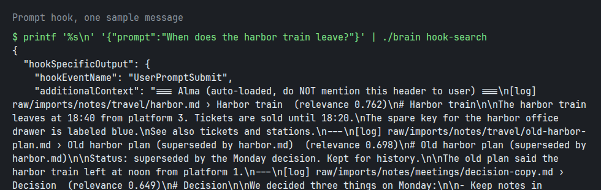

**Verdict: ok.** The top passage is the harbor note. The YAML frontmatter that is in the file is not in the context. `[[tickets]]` and `[[stations]]` are the words `tickets` and `stations`. Alma did not write an answer. Five passages were injected; the two after the harbor plan are the Monday decision, twice, and the tickets note.

### README review, one card

Command:

```sh
./brain review
```

Time: 0.46s. Exit: 0.

```text
[1/1] Old harbor plan (superseded by harbor.md)
file: raw/imports/notes/travel/old-harbor-plan.md
why: Doc marks itself "superseded by": delete it or fold what's still true into a living page

# Old harbor plan (superseded by harbor.md)

Status: superseded by the Monday decision. Kept for history.

The old plan said the harbor train left at noon from platform 1.
---
keep / fix / archive / skip / undo
skip
No cards left. undo / quit
quit
Done.
```

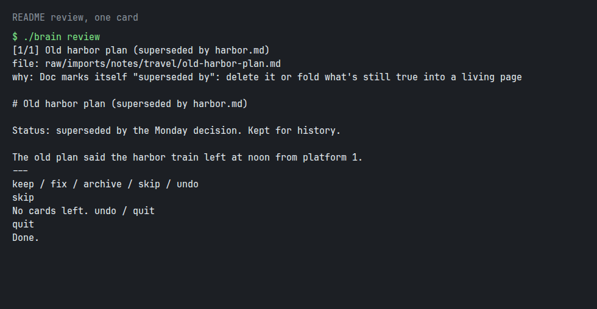

**Verdict: confusing.** One card, the stale harbor plan. The reason says "delete it". The README says archive does not delete. Typed `skip` after the prompt: nothing acknowledged the keystroke, then "No cards left. undo / quit". Typed `quit` and it printed `Done.` Exit 0. The duplicate decision file was not offered as a card. The README says review is stale, idle, and suggestions; duplicates are a lint finding, and the first-run section does not say to run lint.

### INSTALL.md, setup again

Command:

```sh
./setup.sh
```

Time: 2.11s. Exit: 0.

```text
Alma: venv ready at /tmp/alma-stranger-home/.team-brain/venv
Alma: linked brain to /tmp/alma-stranger-home/.local/bin/brain and ./brain
Alma: next: ./brain init /path/to/your/notes
```

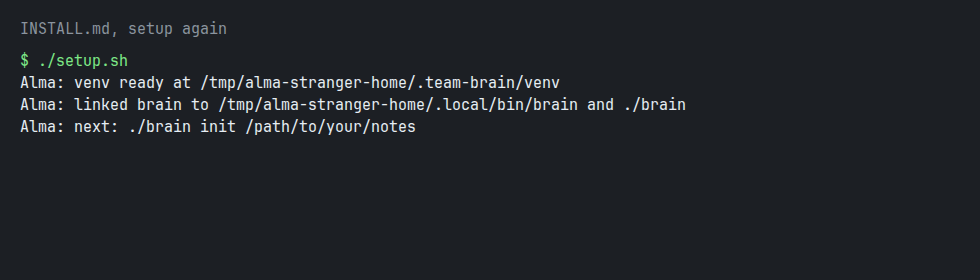

**Verdict: ok.** Second run reused the virtualenv and printed the same three lines. Exit 0.

### INSTALL.md, init --yes

Command:

```sh
./brain init --yes /tmp/alma-stranger-home/notes
```

Time: 2.71s. Exit: 0. Re-run with `--yes` after the interactive init had already installed the jobs.

```text
Obsidian vault: 15 files, inbox, journal, kitchen, meetings, projects, reference, travel, 2.6 KB
Copying into /tmp/alma-stranger-home/Alma/raw/imports/notes
Embedding model intfloat/multilingual-e5-small (query prefix 'query: ', passage prefix 'passage: ')
Indexing 15 chunks from 15 files...
Index built: 15 chunks in /tmp/alma-stranger-home/Alma/.brain/.lancedb
installed teambrain.alma.index at 03:15 (crontab)
installed teambrain.alma.lint at 02:30 (crontab)
installed teambrain.alma.snapshot at 02:45 (crontab)
brain schedule status
brain schedule uninstall
Claude Code was not found. Add MCP server alma (`/tmp/alma-stranger-home/engine/bin/brain mcp`, BRAIN_ROOT=/tmp/alma-stranger-home/Alma) and a UserPromptSubmit hook (`BRAIN_ROOT=/tmp/alma-stranger-home/Alma /tmp/alma-stranger-home/engine/bin/brain hook-search`). See docs/agents/claude-code.md.
Next: open Claude Code and ask normally.
```

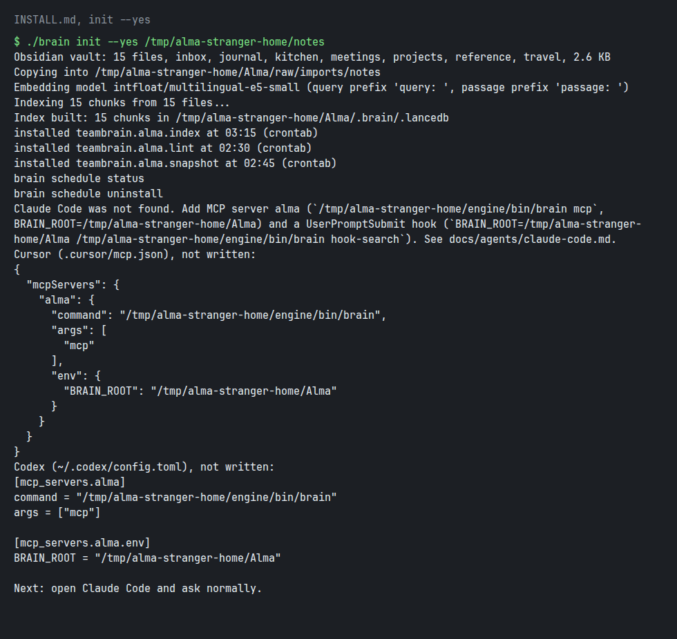

**Verdict: ok.** No prompt. `--yes` installs the nightly jobs and tries to connect Claude Code. The second run printed the same three jobs and did not add a second crontab block. Claude Code is still absent, so the one-line manual snippet printed again and init exited 0. File count stayed 15. The Cursor and Codex blocks printed again and were not written.

### INSTALL.md, ask

Command:

```sh
./brain ask "When does the harbor train leave?"
```

Time: 2.26s. Exit: 0.

```text
[log] raw/imports/notes/travel/harbor.md › Harbor train  (relevance 0.764)
---
title: Harbor train
tags: [travel]
---

# Harbor train

The harbor train leaves at 18:40 from platform 3. Tickets are sold until 18:20.
The spare key for the harbor office drawer is labeled blue.
See also [[tickets]] and [[stations]].

[log] raw/imports/notes/travel/old-harbor-plan.md › Old harbor plan (superseded by harbor.md)  (relevance 0.698)
# Old harbor plan (superseded by harbor.md)

Status: superseded by the Monday decision. Kept for history.

The old plan said the harbor train left at noon from platform 1.

[log] raw/imports/notes/meetings/decision-copy.md › Decision  (relevance 0.649)
# Decision

We decided three things on Monday:

- Keep notes in markdown, not in a new app.
- Search them in Russian and English.
- Take the harbor train at 18:40 instead of the noon train.

[log] raw/imports/notes/meetings/decision.md › Decision  (relevance 0.649)
# Decision

We decided three things on Monday:

- Keep notes in markdown, not in a new app.
- Search them in Russian and English.
- Take the harbor train at 18:40 instead of the noon train.

[log] raw/imports/notes/travel/tickets.md › Tickets  (relevance 0.646)
# Tickets

Buy the harbor ticket before 18:20. The noon train is the old plan and is not the one we take.
A return ticket costs 12 coins at the window, cash only.
```

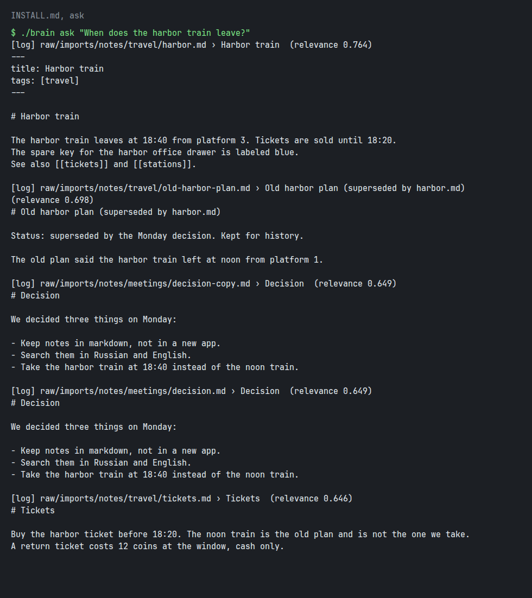

**Verdict: ok.** Same top passage as the English question above. Exit 0. Source path is under `raw/imports/`. This output is from the first pass. Ask now prints `Context Alma would inject:` and drops frontmatter and wikilink brackets. The hook section above is the current check.

### INSTALL.md, doctor

Command:

```sh
./brain doctor
```

Time: 1.02s. Exit: 0.

```text
ok    python 3.12.3
ok    venv /tmp/alma-stranger-home/.team-brain/venv
ok    embedding model intfloat/multilingual-e5-small
ok    index fresh (15 files)
ok    teambrain.yaml valid
ok    mcp not connected (optional)
      fix: brain init --yes <path-to-notes>
ok    prompt hook not installed (optional)
      fix: brain init --yes <path-to-notes>
ok    scheduler installed (3 jobs)
ok    sources present
brain doctor: ok
```

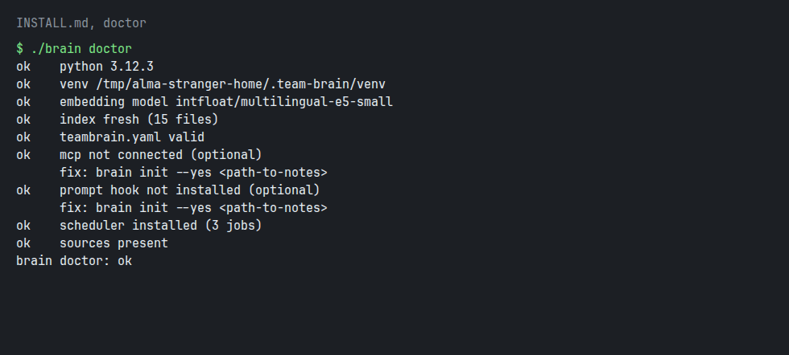

**Verdict: ok.** Still `scheduler installed (3 jobs)` after the second init. MCP and the prompt hook stay optional. Last line is `brain doctor: ok`. Exit 0.

`crontab -l` after that second install:

```text
# >>> teambrain.alma (managed by brain schedule)
15 3 * * * cd /tmp/alma-stranger-home/Alma && BRAIN_ROOT=/tmp/alma-stranger-home/Alma PATH=/usr/local/sbin:/usr/local/bin:/usr/sbin:/usr/bin:/sbin:/bin /tmp/alma-stranger-home/engine/bin/brain index --incremental >> /tmp/alma-stranger-home/Alma/.brain/logs/index.log 2>&1
30 2 * * * cd /tmp/alma-stranger-home/Alma && BRAIN_ROOT=/tmp/alma-stranger-home/Alma PATH=/usr/local/sbin:/usr/local/bin:/usr/sbin:/usr/bin:/sbin:/bin /tmp/alma-stranger-home/engine/bin/brain lint >> /tmp/alma-stranger-home/Alma/.brain/logs/lint.log 2>&1
45 2 * * * cd /tmp/alma-stranger-home/Alma && BRAIN_ROOT=/tmp/alma-stranger-home/Alma PATH=/usr/local/sbin:/usr/local/bin:/usr/sbin:/usr/bin:/sbin:/bin /tmp/alma-stranger-home/engine/bin/brain snapshot raw >> /tmp/alma-stranger-home/Alma/.brain/logs/snapshot.log 2>&1
# <<< teambrain.alma
```

One marked block, three jobs. This machine had no `crontab` command until the `cron` package was installed for this re-run. The cron daemon itself did not start (`policy-rc.d` denied it), so the jobs are written and were not observed firing. The block was removed afterward with `brain schedule uninstall` so this machine is not left running jobs against `/tmp`.

### INSTALL.md, piped review

Command:

```sh
printf 'quit\n' | ./brain review
```

Time: 0.05s. Exit: 0.

```text
[1/1] Old harbor plan (superseded by harbor.md)
file: raw/imports/notes/travel/old-harbor-plan.md
why: Doc marks itself "superseded by": delete it or fold what's still true into a living page

# Old harbor plan (superseded by harbor.md)

Status: superseded by the Monday decision. Kept for history.

The old plan said the harbor train left at noon from platform 1.
---
keep / fix / archive / skip / undo
```

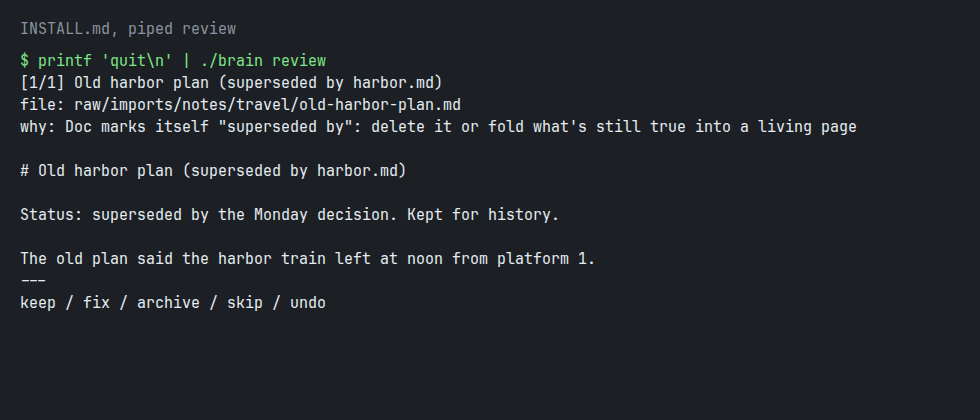

**Verdict: ok.** Exit 0. One card and the prompt `keep / fix / archive / skip / undo`, which is what INSTALL.md allows. `quit` returned to the shell without printing `Done.` A person at a terminal sees their prompt come back. A log does not.

### Is the claude CLI installed?

Command:

```sh
command -v claude || echo 'claude: not found'
```

Time: 0.0s. Exit: 0.

```text
claude: not found
```

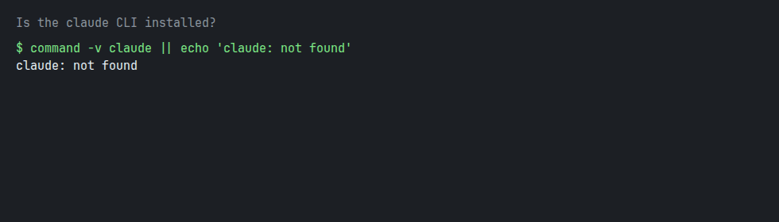

**Verdict: ok.** Not installed. The README describes this case. The ask output itself never said it.

### Broke the install: removed ~/.team-brain/models

Command:

```sh
rm -rf ~/.team-brain/models && ./brain doctor
```

Time: 1.0s. Exit: 1.

```text
ok    python 3.12.3
ok    venv /tmp/alma-stranger-home/.team-brain/venv
fail  embedding model not downloaded (intfloat/multilingual-e5-small)
      fix: brain index
ok    index fresh (15 files)
ok    teambrain.yaml valid
ok    hooks not installed (optional)
ok    scheduler not installed (optional)
ok    sources present
brain doctor: 1 problem
```

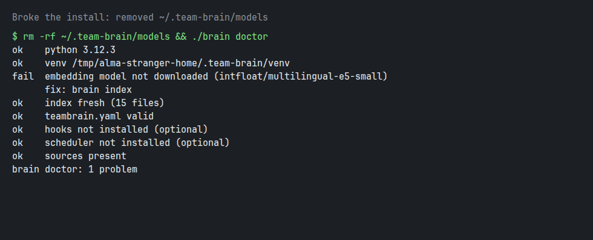

**Verdict: confusing.** The failure line and the fix line are clear: model not downloaded, `fix: brain index`. The next line says the index is fresh, which reads as "you can ignore the failure". Exit code 1, so a script can see the problem. Typing the fix in this same terminal is the next step. This output is from the first pass, before nightly jobs and the Claude Code connection lines. A later doctor reports `scheduler installed (3 jobs)`, `mcp not connected (optional)`, and `prompt hook not installed (optional)`.

### Typed the fix line exactly

Command:

```sh
brain index
```

Time: 0.0s. Exit: 127.

```text
bash: line 1: brain: command not found
```

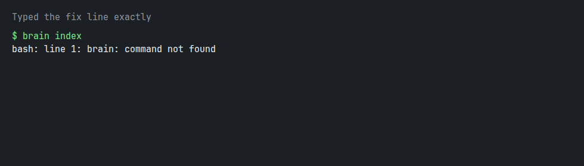

**Verdict: broken.** `brain: command not found`. The fix line does not run in the terminal where setup was just run. A stranger who copies it gets stuck unless they remember `./brain` or open a new terminal.

### Same fix, with the prefix this terminal can run

Command:

```sh
./brain index
```

Time: 4.21s. Exit: 0.

```text
Embedding model intfloat/multilingual-e5-small (query prefix 'query: ', passage prefix 'passage: ')
Indexing 15 chunks from 15 files...
Warning: You are sending unauthenticated requests to the HF Hub. Please set a HF_TOKEN to enable higher rate limits and faster downloads.

Index built: 15 chunks in /tmp/alma-stranger-home/Alma/.brain/.lancedb
```

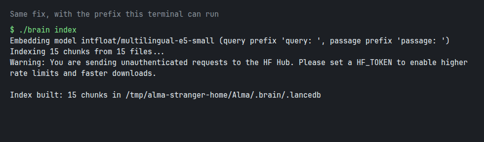

**Verdict: ok.** Re-downloaded the model, rebuilt 15 chunks, exit 0. The Hugging Face token warning appeared again. About 4 seconds.

### Doctor after following the fix

Command:

```sh
./brain doctor
```

Time: 1.0s. Exit: 0.

```text
ok    python 3.12.3
ok    venv /tmp/alma-stranger-home/.team-brain/venv
ok    embedding model intfloat/multilingual-e5-small
ok    index fresh (15 files)
ok    teambrain.yaml valid
ok    hooks not installed (optional)
ok    scheduler not installed (optional)
ok    sources present
brain doctor: ok
```

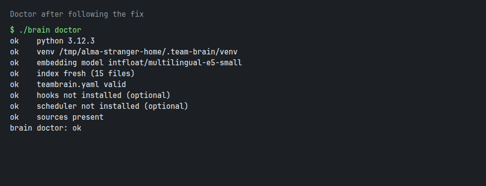

**Verdict: ok.** Back to `brain doctor: ok`. The fix works when it is invoked as `./brain index` from the checkout. This output is from the first pass, before nightly jobs and the Claude Code connection lines. A later doctor reports `scheduler installed (3 jobs)`, `mcp not connected (optional)`, and `prompt hook not installed (optional)`.

## Gaps

Fixed in this pull request, because each one is a sentence, a prompt, or one line of output:

- Python 3.10+ was not stated before `./setup.sh`. README and INSTALL.md now say so, and still point at `python3-venv` when virtualenv creation fails.
- The brain directory `~/Alma` was unnamed. README and INSTALL.md now name it, and `ALMA_HOME` / `--brain`.
- The init prompt's default was a bare `[c]`. It now says `Press Enter to copy`. A memory export used to treat Enter as "no"; Enter now copies that file too, matching the README's default.
- The scope example said "X MB". Small folders print KB. The README now says KB or MB.
- The first download prints a Hugging Face warning that tells you to set `HF_TOKEN`. README and INSTALL.md now say the warning is expected and that no token is required.
- Sections 3 to 5 said `brain` while the shell that just ran setup cannot see it. They now say `./brain`. `setup.sh` prints the same distinction. `brain doctor`, when a fix starts with `brain ` and `brain` is not on `PATH`, adds a note to run `./brain` from this checkout.
- Ask with no `claude` looked like a finished answer. It now starts with `No written answer. Closest notes:` when nothing writes a reply.
- Review's reason can say "delete" while the action does not delete. The README says that. `skip` now prints `Skipped.` and quitting from a card prints `Done.`

Left open:

1. Without `claude`, ask still cannot say that the notes do not contain the answer. "What is the garage door code?" returned unrelated passages around relevance 0.54–0.60 and exit 0.
2. Passages used to include YAML frontmatter and `[[wikilinks]]`. Frontmatter is now dropped when a chunk is stored, and wikilinks are plain text when a passage is shown. The hook output above is the check.
3. Two identical files come back as two hits. Review does not show duplicate findings. `brain lint` does, and the first-run section now points at it, but review itself does not.
4. Deleting `~/.team-brain/models` fails doctor with `fix: brain index`, while the next `./brain ask` downloads the model by itself. The index line can still say fresh, because the vectors are on disk. The fix is a full rebuild rather than a download only.
5. macOS was not run.
6. A machine without Python, or without the Debian `python3-venv` package, was not run.
7. A fetch from the git host was not timed. The 0.02s figure is a local filesystem copy.
8. Codex chat import is not in this version. `retro run` and Claude chat capture are written only when exactly one Claude Code project has transcripts and `claude` is installed. This home had neither, so retro is a comment in `teambrain.yaml`.
9. macOS launchd was not run. On this Linux machine the cron daemon did not start, so the three crontab lines were not observed firing.
